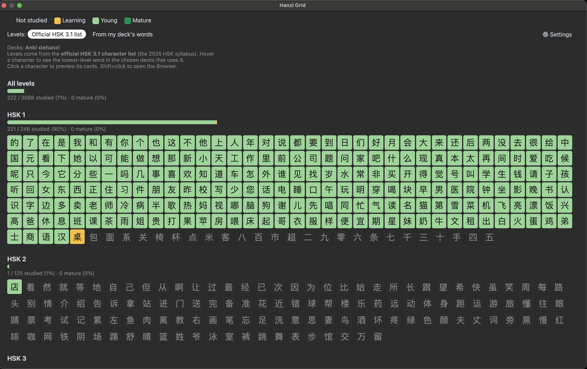
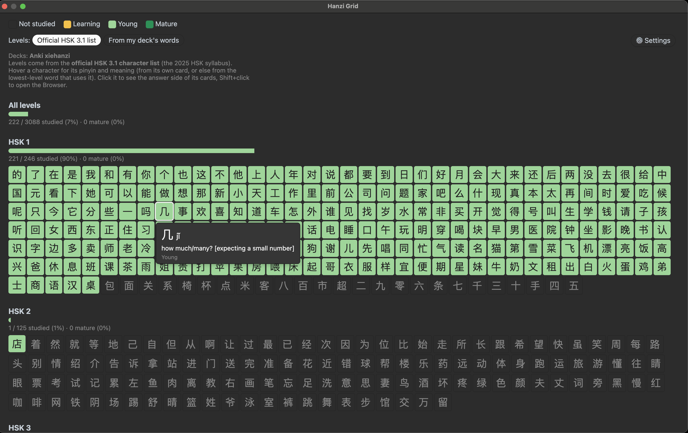
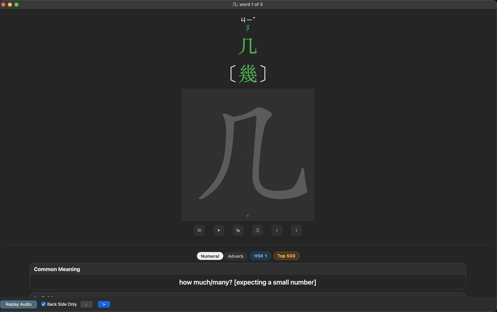
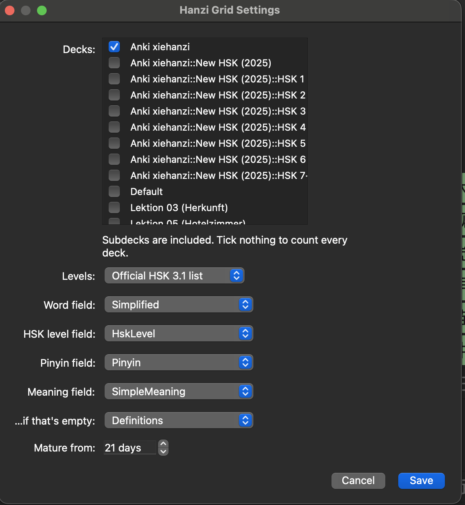

# Hanzi Grid

An Anki add-on that shows every Chinese character in your decks on one
screen, grouped by HSK level and coloured by how well you know it, with a
progress bar for each level.



## Features

- **One tile per character**, coloured by your best card containing it:

  | Colour | Meaning |
  | --- | --- |
  | outline | not studied yet (never answered) |
  | yellow | learning / relearning |
  | light green | young (in review, interval under 21 days) |
  | dark green | mature (interval 21 days or more) |
  | gold on deep green | mastered (interval 90 days or more, and the last 3 reviews answered correctly) |

  The interval is the one your last answer gave the card, so moving a card
  with **Set due date** doesn't make it mature, and a card put into review
  that way without being answered still counts as not studied. A forgotten
  card drops back to learning; after that it needs 3 correct reviews in a
  row again to be mastered. **Suspended cards are ignored**, so suspending
  a card with a mistake stops it colouring its characters.

  A character takes the best colour among all cards whose word contains it,
  so 学 turns green once you know 学习 *or* 学生.
- **Grouped by HSK level** (official HSK 3.1 character list, or worked out
  from your deck's word levels; see below).
- **Progress bars** for each level and for all levels together, with
  "studied", "mature" and "mastered" numbers.
- **Hover a character** to see its pinyin and meaning.
- **Click a character** to see the answer side of the cards of every word
  that contains it, in Anki's own preview window. **Shift+click** to find
  them in the Browser.
- **Settings window** to choose decks, level source, fields and the mature
  and mastered thresholds.
- **Read-only:** the add-on never changes your cards or notes.





*Card shown: from the [Anki-xiehanzi](https://github.com/krmanik/Anki-xiehanzi) deck.*

## Install

**From AnkiWeb:** in Anki, open **Tools → Add-ons → Get Add-ons…**, paste
the code `967323486` and restart Anki
([add-on page](https://ankiweb.net/shared/info/967323486)).

**From a file:** download `hanzi_grid-<version>.ankiaddon` from the
[Releases page](https://github.com/bpachniewsk1/anki-hanzi-grid/releases),
double-click it (or use **Tools → Add-ons → Install from file…**) and
restart Anki.

Requires Anki 24.06 or newer on desktop (Windows, macOS, Linux). Add-ons
don't run on AnkiMobile, AnkiDroid or AnkiWeb.

## Quick start

Once it's installed:

1. In Anki's main window, open **Tools → Hanzi Grid**.
2. Click **⚙ Settings** at the top right of the grid, tick your Chinese
   deck(s), choose the fields that hold the word, pinyin and meaning, and
   click **Save**. The grid reopens with your characters. (Using the
   [Anki-xiehanzi](https://github.com/krmanik/Anki-xiehanzi) deck? The
   defaults already fit it, so you can skip this step.)

## Use

1. **Tools → Hanzi Grid**.
2. Hover a character to see its pinyin, meaning and status. They come from
   the character's own card (学) if your decks have one, otherwise from the
   lowest-level word that uses it (学生, with 学 highlighted).
3. Click a character: a preview window shows the answer side of the card
   of its first word. Press **>** (or Right arrow) for the next word,
   **<** (or Left arrow) to go back.
4. Shift+click a character to open the Browser with all those cards.
5. Use the **Levels** buttons to switch where levels come from, and
   **⚙ Settings** for everything else.

Colours are worked out each time the grid opens, so reopen it after
reviewing.

## Settings

Click **⚙ Settings** in the grid, or select Hanzi Grid in
**Tools → Add-ons** and click **Config**.



| Setting | What it does | Default |
| --- | --- | --- |
| Decks | Decks to count. Subdecks are included. Tick nothing to count every deck. | `Anki xiehanzi` |
| Levels | Official HSK 3.1 list, or from your decks' words. | Official HSK 3.1 list |
| Word field | The field with the Chinese word (simplified characters). | `Simplified` |
| HSK level field | The field with the word's HSK level, e.g. `HSK 3`. Only used for "from my deck's words". | `HskLevel` |
| Pinyin field | Shown when hovering a character. | `Pinyin` |
| Meaning field | Shown when hovering a character. If it's empty for a word, the second meaning field is used. Long meanings are cut at 120 characters. | `SimpleMeaning`, then `Definitions` |
| Mature from | Interval in days from which a card counts as mature. | 21 days |
| Mastered from | Interval in days from which a card counts as mastered (at least the mature value). | 90 days |

The defaults fit the [Anki-xiehanzi](https://github.com/krmanik/Anki-xiehanzi)
"New HSK (2025)" deck. For other decks, pick your deck and its field names.
`config.md` describes the stored settings keys.

## Where the character levels come from

You choose between two sources. The grid always says which one is active.

### Official HSK 3.1 list (default)

Each character's level is its level in the **official character list of the
2025 HSK syllabus** (新版HSK考试大纲, December 2025). "HSK 3.1" is an
unofficial name for that 2025 version, used to tell it apart from the 2021
HSK 3.0 syllabus.

The list has 3,088 characters: 246 (HSK 1), 125 (HSK 2), 284 (HSK 3),
441 (HSK 4), 431 (HSK 5), 413 (HSK 6) and 1,148 (HSK 7–9). Characters on the
list that no word in your decks uses are still shown, as "not studied".

### From my deck's words

> **These are not official HSK character levels.** They are worked out from
> the word levels in your decks with the rule below, and can differ from the
> official character list.

**Rule:** a character's level is the lowest HSK level of any word in the
chosen decks that contains it.

1. Take every note in the chosen decks.
2. Read the word from the word field and the level from the HSK level field.
   The level is the first number in that field, so `HSK 7+` counts as 7.
   Notes with no number in the level field are skipped for this step.
3. Every character in the word gets that level as a candidate, and keeps
   the lowest level it gets from any word.

Examples from the xiehanzi deck: 校 is HSK 1 (from 学校), 然 is HSK 2 (from
虽然), 展 is HSK 3 (from 发展).

The level says where your deck first teaches a word containing that
character, not how hard the character is on its own. Another deck, or
another version of the HSK word lists, can give different levels.

### How close are the two?

With the xiehanzi "New HSK (2025)" deck, the rule gives the same level as
the official list for 3,079 of the 3,088 official characters:

- 3 characters get a different level: 店 (official HSK 2, but in the HSK 1
  word 商店), 饺 (official HSK 3, but in the HSK 1 word 饺子) and 留
  (official HSK 2, but first in the HSK 3 word 留学). The syllabus itself is
  inconsistent here.
- 6 official characters appear in no word in the deck: 著 糊 劈 溜 猛 脊.

### Other

Characters you've studied that have no level are shown under **Other**.

## Problems or ideas?

Open an issue at https://github.com/bpachniewsk1/anki-hanzi-grid/issues. Please include your Anki version
(**Help → About**) and, if there was an error window, its text.

## Privacy

Hanzi Grid works offline. It sends nothing anywhere, collects no data and
only reads your collection. The only thing it writes is its own settings, in
`meta.json` in the add-on folder (Anki's usual place for add-on settings).

## Known limits

- Only simplified characters are counted (whatever the word field holds).
- Suspended cards still count with the status they had when suspended.
- Only one word field can be picked in Settings (the stored setting accepts
  a list).
- In the Settings deck list, subdecks of a ticked deck show as unticked but
  are counted.
- The preview window builds on internal parts of Anki's own previewer, so a
  future Anki version may need a small update.

## For developers

| File | What it is |
| --- | --- |
| `__init__.py` | Adds **Tools → Hanzi Grid**, builds the grid in the background, shows the window. |
| `grid_data.py` | Reads notes and cards and builds the groups. No user interface code, so it can be tested outside Anki. |
| `previewer.py` | The preview window, a small subclass of Anki's own card previewer. |
| `settings.py` | The Settings window, built from standard Qt widgets. |
| `config.json` / `config.md` | Default settings and a description of each key. |
| `manifest.json` | Name, version and minimum Anki version, read when installing a `.ankiaddon` file. |
| `data/hsk3.1/` | Official HSK 3.1 character lists, one file per level, with their source and license. |
| `build_ankiaddon.py` | Builds the `.ankiaddon` package into `build/`. |

**Try local changes:** link this folder into Anki's add-on folder and restart
Anki after each change (on macOS):

```bash
ln -s "$PWD" ~/Library/Application\ Support/Anki2/addons21/hanzi_grid
```

**Build the package:**

```bash
python3 build_ankiaddon.py
```

Tested with Anki 25.09.4. The Anki functions it uses were checked to exist
unchanged in Anki 24.06.3, 24.11 and 25.02.7.

See [CHANGELOG.md](CHANGELOG.md) for changes between versions.

## License and credits

Hanzi Grid is free software: you can redistribute it and/or modify it under
the terms of the **GNU Affero General Public License, version 3 or later**
(the same license as Anki). See [LICENSE](LICENSE).
Copyright © 2026 bpachniewsk1.

Bundled data: the HSK 3.1 character lists in `data/hsk3.1/` come from
["More than enough Hanzi"](https://github.com/becky82/mteh) by Rebecca J.
Stones, © 2025, licensed under
[CC BY-SA 4.0](https://creativecommons.org/licenses/by-sa/4.0/), copied
unchanged. Those files stay under CC BY-SA 4.0; see
[data/hsk3.1/SOURCE.md](data/hsk3.1/SOURCE.md).

Inspired by the character overview in Duolingo's Chinese course and by the
Kanji Grid add-on for Anki. Hanzi Grid is written from scratch and isn't
affiliated with or endorsed by either. It also isn't affiliated with the
organisers of the HSK exam. "HSK" is used only to describe the levels.
